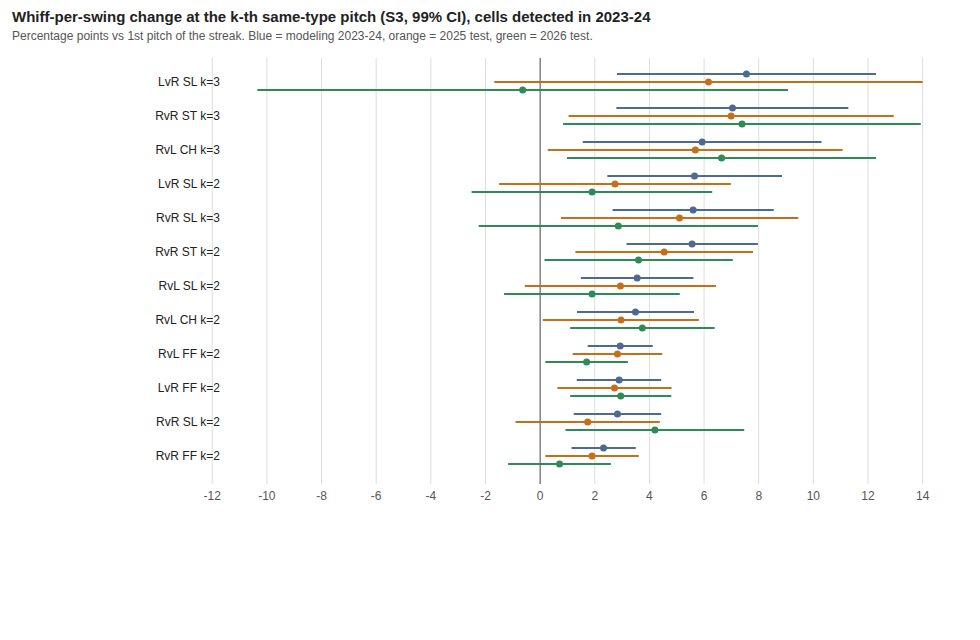

# P5 最終報告：連投、序列與配球的歷史研究（2023–2026 例行賽）

> **全部結論只代表歷史資料**：描述的是「歷史上發生了什麼」，不是「改投別的球會怎樣」；位置是實際進壘點，不是瞄準點。
> 資料版本 `2026-10-06_2026-10-06_20261006T121748.803442Z_c1703bd38919`；凍結紀錄見 `P5_FROZEN.md`；逐步紀錄見 `P5_LOG.md`；每個研究專案的見解與研究檔在 `insights/`、`bundles/`。

## 1. 摘要表

| # | 問題 | 結論 | 證據等級 |
|---|---|---|---|
| Q1 | 連投 | 同一球種連投第 2、3 顆，對**投手更有利**：打者較少揮棒、揮棒時更常揮空（常見 +2 到 +6 個百分點）、不揮棒時更常被判好球、較少打成界內球，每球平均價值下降約 0.01 分。方向與「連投衰減」的直覺**相反**。沉降球（SI）、切速球（FC）、曲球（CU）大多沒偵測到 | **強**（建模期偵測到，且 2025、2026 重現；k=3 比 k=2 保守） |
| Q2 | 前一球 | 當前球與前一球「不同球種」時，相對前一球同球種，揮空率較低、平均價值較高（對投手較不利）——與 Q1 同方向 | **中**（建模期偵測到；2025、2026 重測方向多半一致但多數格區間含 0、約 10%–25% 反號；無分季重複與 S4） |
| Q3 | 記憶長度 | 序列資訊在控制投手、打者後只有微小增益：建模期 RvR、RvL 為 1，LvR、LvL 為 0；2025、2026 檢驗與全期間資料下四組都是 1；增益 ≤ 0.001 logloss | **中**（左投兩組在建模期與檢驗期不一致） |
| Q4 | 位置 | 全壘打率集中在好球帶中段兩格（單格最高約 2.5%）；揮空率最高在好球帶下緣與外側 | 描述（不評等級） |
| Q5 | 期望值與尾端風險 | 同一情境下，球種間平均價值差多半小於雜訊：456 組配對只有 14 組超過 2.58 標準誤（純偶然預期約 4.6）；全壘打率每球約 0.5%–1.0% | 描述 |
| Q6 | 揮棒品質分項 | 揮空時 `miss_distance`：FF 平均 1.06 英寸、CH 3.63、SL 4.97；球棒追蹤整段 2023-07-14 前缺失 | 描述 |
| Q7 | 樣本外 | 見第 4 節：2025 幾乎全部重現，2026 大致重現 | 見 Q1、Q3 |
| Q8 | 全期間附加研究 | 方向與大小與建模期大致相同，區間變窄（標準誤約 0.7 倍） | 無乾淨檢驗集 |

## 2. 方法（為什麼這些結論可信，以及可信的程度）
- **主要估計式**：固定效應線性機率模型（投手＋打者固定效應，控制球數與同球種已投球數），標準誤以投手分群，99% 區間；規格階梯 S2（無個體效應）、S3（主）、S4（投手×比賽＋打者）、S5（加前一球結果、位置、球速）。
- **已知答案測試**：合成世界 T0–T3（零效應、有效應、球種危險率不同、投手混合）全部通過；21 項檢查。
- **不採用的方法**：同點分層比較（S1）在真實資料上有結構性偏誤（安慰劑 +2 到 +6 pp，比觀察值還大）；提升樹的序列增益在三個種子下符號不一致，只作穩健性、不作結論。
- **安慰劑**：迴歸版安慰劑（S3）中位數 k=2 約 +0.4 pp、k=3 約 +1.0 pp，觀察值中位數 +2.2、+2.4 pp，所以大部分效應不是方法造成的，但 **k=3 要比 k=2 保守**。
- **偵測準則（預先登記）**：S3 的 99% 區間不含 0、S4 同號且至少一半、2023 與 2024 分開同號且各至少 1/3、實務大小（1 pp；平均價值 0.002）、分群數 ≥ 30。

## 3. 建模期（2023–2024）結果
詳見 `insights/P5-2_describe.md`、`P5-3_streak.md`、`P5-4_sequence.md`。要點：
- 偵測到的格數／檢定格數（純偶然預期約 0.5–0.6）：揮空率 12／52、揮棒率 7／60、好球判決率 15／56、界內球率 14／52、平均價值 8／60、界外率 1／52；全壘打率在 1 pp 門檻下 0 格（基礎率 0.9%，門檻不可能達成，事後改用 0.2 pp 為 3／60，全為負）。全部偵測到的效應**方向一致**。
- 規格階梯符號翻轉佔全部估計 15%（低於 20% 停止門檻）；`foul_per_swing` 單獨 29%，標「不穩定」。

## 4. 最終檢驗（P5-6；設定凍結、各只跑一次、2025 與 2026 分開）
見 `insights/P5-6_final_test.md`、`summaries/final_test_streak_grades.json`、圖 `figures/P5-6_whiff_forest.png`（揮空率偵測格：建模期、2025、2026 的 S3 估計與 99% 區間）。

- 建模期偵測到的 60 格連投效應：**2025：54 強、4 中、1 弱、1 被反駁；2026：55 強、1 中、4 被反駁**（4 格中 2 格為好球判決類，2026 受 ABS 影響，不當作模型失準的證據）。
- 揮空率 12 格在 2025 全部「強」；2026 有 11 格強、1 格中（LvR 滑球 k=3，估計反號但區間很寬）。
- **前一球（Q2，A7 前一球迴歸，S3）**：建模期偵測到的格數（揮空率 36、揮棒率 26、平均價值 20），在 2025／2026 同號且區間不含 0 的格數：揮空率 14／13、揮棒率 6／7、平均價值 2／1；同號但區間含 0：16／15、14／15、12／14；反號：3／3、4／2、5／4（其餘為單季球數不足）。方向大致支持，但**遠不如連投穩固**，所以 Q2 只給「中」。逐格結果 `summaries/final_test_prev1_grades.json`。
- 記憶長度：兩個年度的 RvR、RvL、LvR 都選 1（LvR 與建模期的 0 不同）；LvL 增益約 0。logloss 約 1.19–1.22，與建模期同量級。
- 2026 的落差是樣本外誤差加上規則與定義改變，無法拆開，不歸因於模型。

## 5. 全期間附加研究（P5-7，X1；沒有乾淨檢驗集）
見 `insights/P5-7_extra_study.md`、`summaries/x1_vs_modeling_streak.json`。
- 與建模期同格比較（k=2、3）：同號格數比例約 80%–95%；99% 區間不含 0 的格數增加（如揮空率 15→23），是因為樣本變多（標準誤約 0.7 倍），平均估計大小反而略降（好球判決率最明顯，與 2026 ABS 一致）。
- 記憶長度（5 折分組交叉驗證）：四組都是 1，增益 +0.0007 至 +0.0009 logloss；m2→m3 在左投兩組為負（過度配適）。
- X1 的準確度**不得**與 P5-6 的 2025／2026 檢驗並列比較。

## 6.「未偵測到」清單（合法結論）
- 沉降球（SI）：RvR 揮空率 −0.9 pp，區間含 0；切速球（FC）、曲球（CU）在多數格未偵測到。
- LvL 組：樣本太少，多格單季球數不足、無法做分季重複，準則 3 判為未達成。
- 同一情境下球種間的平均價值差：在約 0.01 分／球的解析度下沒有一致、可操作的差距。
- 序列資訊對「每球期望得分」預測的改善：多數區間含 0。
- 界外率的連投效應：僅 1／52 格達標，且 2026 反號，標不穩定。

## 7. 限制
- 隱藏因素（投手為什麼這樣選球、捕手與戰況）無法排除；固定效應迴歸是線性機率模型。
- 最小可偵測效應：揮空率約 1.5–2 pp 以上（視格樣本）；比這小的效應不能主張不存在。
- 2026 的好球帶／ABS 與座標定義改變，好球判決類結論在 2026 不可比較。
- 邏輯迴歸基準偏弱（RvR 提升樹 logloss 1.1345 對邏輯迴歸 1.2226），所以「序列增益很小」是相對於「邏輯迴歸＋個體效應」的結論。
- 分級腳本 `scripts/grade_final.py` 在看到結果後才撰寫，規則照計畫 2.4 字面實作；「|z|<2」的判準在標準誤大時偏寬鬆。
- 偏離預先登記之處（均已逐項記在 `P5_LOG.md`）：`hr_per_pitch` 事後 0.2 pp 門檻；新增迴歸安慰劑 A10b 作診斷；`outcome_model` 新增記憶階梯；X1 三份迴歸提高 `max_rows`；A8 X1 耗時超過 5 倍估計（使用者指示繼續）。

## 8. 給 P6 的輸入
1. **存在連投與前一球效應**，方向是「同球種連投對投手有利」，大小：揮空率 +2 到 +6 pp、平均價值約 −0.01 分／球（k=2、3，四縫線速球、滑球、橫掃球、變速球最明顯）。
2. **效應形狀**：k=2 到 k=3 大致隨 k 增加或持平，k≥4 未單獨驗證（`kmax=4`，資料量遞減）；P6 先用 k≤3。
3. **記憶長度**：1 顆。更長不增加預測力（增益 ≤ 0.001 logloss，m2→m3 常為負）。
4. **可信的價值表**：A1 的得分期望值表（288 狀態全有資料、最小 n=37；與 Savant 對照見 run #4），建模期與 2025、2026、全期間各一份可比。
5. **四組資料量與信賴程度**：RvR、RvL 資料多、結論最穩；LvR 次之；**LvL 資料最少（建模期約 10 萬球），序列資訊在現有樣本下不可靠**。
6. **建議模型**：邏輯迴歸＋投手與打者個體效應＋前一球球種（記憶 1）作為可解釋基準；若要用提升樹，必須先解決小組過度擬合（早停、正則化、更少棵數）並以留出集校準。
7. **P6 不可做的事**：用本研究的結果宣稱「改投某球會讓結果變好」——選擇偏誤無法排除。
